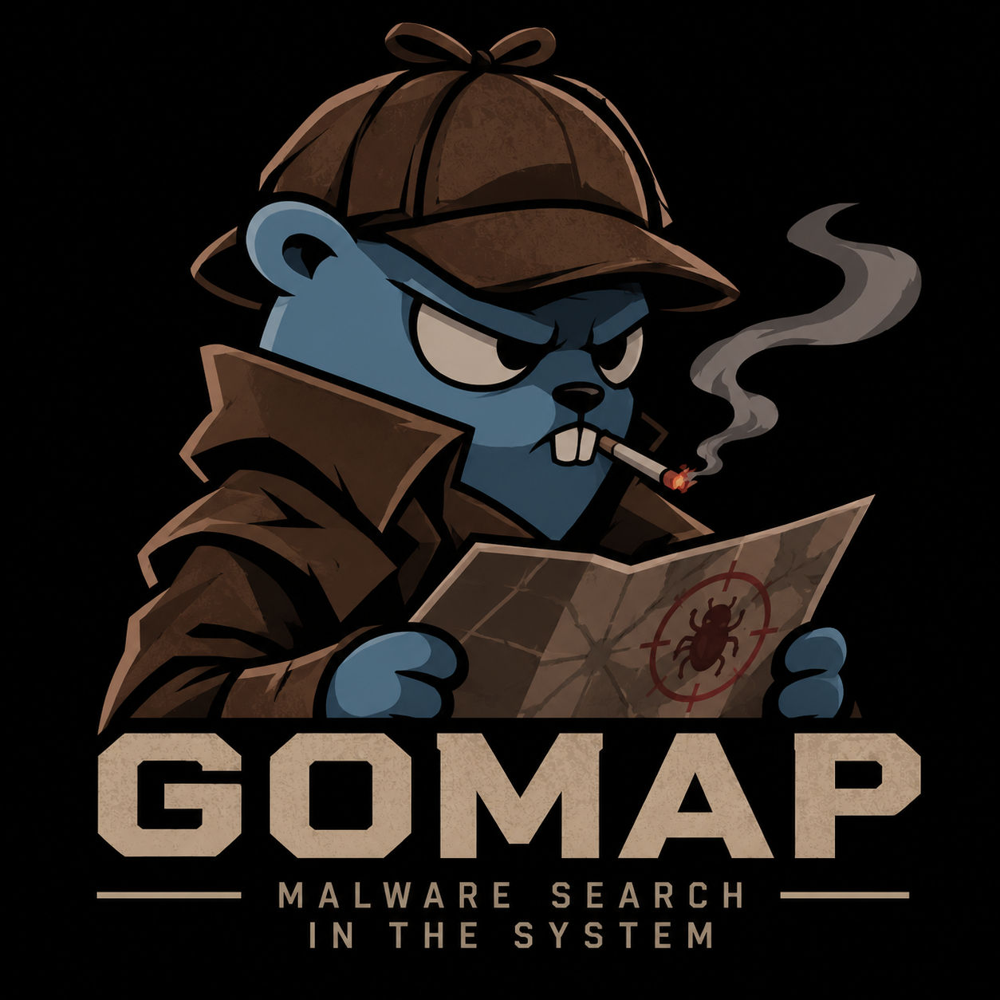

<div align="center">
  
  <h1>GOMAP</h1>
  <p><strong>Malware Search in the System</strong><br>Static file analysis from the command line</p>
</div>

---

GOMAP inspects suspicious files without executing them. It calculates hashes, checks local byte signatures, extracts metadata and statically parses Windows PE files. Heuristic findings are indicators, not proof of infection.

## Quick start

```sh
go build -o gomal-scan ./cmd/gomal-scan
./gomal-scan
./gomal-scan scan ./suspicious-file.exe
```

Launching with no arguments displays the GOMAP ASCII banner. Use `--help` to see available commands.

```sh
./gomal-scan scan ./folder --format json --output report.json
./gomal-scan scan ./folder --format html --output report.html
./gomal-scan history
```

## Features

| Feature | Details |
|---|---|
| File identity | SHA-256, size, MIME type, extension and modification time |
| Windows PE | Headers, sections and imported libraries; files are never launched |
| Local signatures | Named hexadecimal byte sequences from your rules file |
| Risk assessment | Explainable heuristic score and findings |
| Reports | Terminal, JSON and HTML |
| History | Local append-only JSON Lines file |

The scanner reads at most 64 MiB per file by default. Symbolic links and non-regular files (including devices and FIFOs) are reported and skipped. A file-level error does not stop the rest of a directory scan.

## Local signature rules

Create a UTF-8 text file with one `name=hex-bytes` rule per line. Blank lines and comments beginning with `#` are ignored.

```text
# Example rules
dos-header=4d5a
sample-marker=746573742d7061796c6f6164
```

Use the rules with `./gomal-scan scan ./samples --signatures rules.txt`.

## Commands and options

| Command or flag | Description |
|---|---|
| `gomal-scan` | Display the startup banner |
| `version` | Print the application version |
| `scan <paths...>` | Scan files and directories |
| `history` | Show the 20 latest local scans |
| `--format text\|json\|html` | Select report format |
| `--output FILE` | Write report to a file |
| `--signatures FILE` | Load local byte signature rules |
| `--yara-rules FILE` | Optionally invoke an installed YARA CLI |
| `--yara-bin PATH` | YARA executable path; default is `yara` |
| `--ti-url URL` | Optional hash-only lookup at `URL/files/{sha256}` |
| `--ti-key TOKEN` | Optional bearer token for the lookup service |

Threat-intelligence lookups disclose file hashes to the configured service. The generic endpoint may need an adapter for your provider. YARA is optional and must be installed separately.

## Risk interpretation

Scores summarize configured indicators and help prioritize review. A signature match or high score does not establish that a file is malicious. A low score does not guarantee that a file is safe.

## History and Docker

History is stored at `gomalscan/history.jsonl` under your operating system's user config directory. The JSON Lines format can be migrated to SQLite in a future version.

```sh
docker build -t gomap .
docker run --rm -v "$PWD:/scan:ro" gomap scan /scan --format json
```

The image runs as a non-root user. Mount inputs read-only. YARA is not bundled in the image.

## Development

Requires Go 1.27.3 or compatible newer version.

```sh
go test ./...
go build ./cmd/gomal-scan
```

GitHub Actions runs tests and build on pushes and pull requests.
